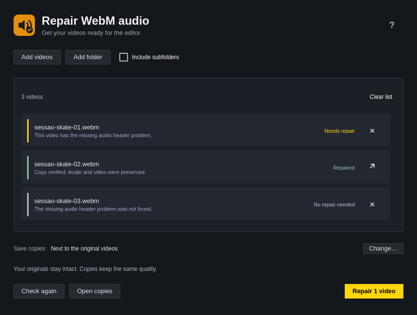

# WebM Audio Fix

A small Linux desktop app that repairs missing Opus audio headers in WebM
files, without re-encoding the video or audio.

## Why this exists

This project started with a specific editing problem: WebM clips exported
from **ReSkate** played with sound in an external player, but their audio
tracks were completely silent in **FilmCraft 0.20.1**.

The sound was present in the files. The six affected clips contained VP8
video and stereo Opus audio, but their Opus tracks were missing
`CodecPrivate` / `OpusHead`: the initialization header that tells a decoder
how to interpret the audio. FFmpeg could decode them anyway; FilmCraft
recognized the audio tracks but exported silence.

Adding the missing header to a copy of a clip restored audio in FilmCraft's
exporter. WebM Audio Fix turns that repair into a reusable tool with a small
interface, so the same problem can be checked and fixed on other files.

This is a targeted compatibility repair. A file reported as needing no repair
simply does not have this missing-header problem; it may have a different
audio issue.

## What it does

- Add videos, drop files into the window, or select a folder. Subfolders are
  optional, and files are checked automatically.
- Mark files with missing or empty Opus initialization headers.
- Reconstruct the header from the track's channel count, sampling frequency
  and `CodecDelay`. The pre-skip is calculated per track, rather than copied
  from the original ReSkate clips.
- Support mono, stereo and multiple audio tracks when the required metadata
  is available.
- Rebuild the WebM container and indexes with FFmpeg stream copy (`-c copy`).
- Show a result for each file and open the folder containing a repaired copy.

The originals are preserved. Copies go into a **WebM corrigidos** folder
next to the source files, or into a folder you choose. Existing output files
are never overwritten. Import the copies into your editor, or relink your
project's media to them; the app does not edit FilmCraft projects.

Processing runs in the background, one file at a time. You can stop after the
current file, or let that file finish before closing the window.

## How a repair is verified

A copy is accepted only after these checks pass:

1. The ordered compressed packet hashes match the original for every stream.
2. Packet presentation, decode and duration times reported by FFprobe match.
3. The decoded PCM16 audio hashes produced by FFmpeg match the original.
4. The output contains the Opus initialization header, and the source file's
   metadata has not changed during processing.

The file is then published atomically without replacing an existing target.
These checks confirm the preserved packet data, reported timing and decoded
PCM16 audio. They do not guarantee compatibility with every editor or player.

The repair engine was tested on the six original ReSkate clips. FilmCraft's
audio exporter produced non-silent output in all nine timeline segments
using the repaired files. Automated tests also cover synthetic media and the
desktop workflow. Listening in the editor is a separate final check.

## Requirements

Tested on **Arch Linux / Omarchy with Qt 6.12**. Windows and macOS builds are
not provided.

- Qt 6: Base, Declarative / Quick Controls, SVG and Wayland
- A C++17 compiler, `make` and `qmake6`
- Python 3.10 or later
- FFmpeg and FFprobe, available on `PATH`
- `xdg-desktop-portal` and a working desktop file chooser backend

On Arch Linux:

```sh
sudo pacman -S --needed base-devel qt6-base qt6-declarative qt6-svg \
  qt6-wayland python ffmpeg xdg-desktop-portal
```

Use the portal backend appropriate for your desktop. The app uses the portal
file chooser rather than a separate toolkit's file dialog.

## Build and install

```sh
git clone https://github.com/braga1k/webmfix.git
cd webmfix
bin/build
bin/test
```

Install for your current user, without administrator privileges:

```sh
bin/install-user
```

This installs the app in `~/.local/bin` and adds a launcher entry and icon to
your account. Search for **WebM** in your application launcher. To run it
directly, use `~/.local/bin/webmfix`.

Alternatively, build and install an Arch package:

```sh
bin/install
```

This uses `makepkg -fsi` and may request administrator authentication for the
installation. No service or scheduled task is created.

## Using the app

1. Choose **Add videos** or **Add folder**, or drop WebM files into the window.
2. Wait for the automatic check. Affected files are marked **Needs repair**.
3. Optionally change the output folder, then click **Repair**.
4. Open the repaired copies in your editor.

Portuguese and English interface text is included. The app follows the
Omarchy language setting when available and defaults to Portuguese when no
setting exists. To launch in English explicitly:

```sh
webmfix open --language en
```

On Omarchy, the accent color and window rounding follow the desktop theme.

| Shortcut | Action |
| --- | --- |
| Ctrl+O | Add videos |
| Space | Repair marked videos |
| ? | Show shortcuts |
| Q | Close; if busy, offer to finish the current file first |

## Command line

The same engine can be used without a display:

```sh
webmfix check clip.webm --json
webmfix repair clip.webm --output ./repaired --json
```

Both commands accept multiple file paths, return JSON, and exit with `0` on
success or `1` on error. `check` does not create repaired copies. Without
`--output`, `repair` uses the **WebM corrigidos** folder next to each source.

The embedded Python tool is also available in the repository at
`src/repair.py`. It supports folder batches, recursive scans and JSON reports:

```sh
python3 src/repair.py ./clips --verificar
python3 src/repair.py ./clips --recursivo --saida ./repaired --relatorio report.json
```

Its command options and diagnostics are in Portuguese. The native app calls
it through a JSON worker, so the script does not need to be installed
separately. Optional instructions for coding agents can be installed with
`webmfix skill install`.

## Limitations

- It cannot recover audio that was never recorded or fix muted tracks,
  playback-device settings or unrelated codec problems.
- It needs a usable channel count, sampling frequency and `CodecDelay`.
- Surround tracks with missing channel maps are refused rather than guessed.
- An existing but invalid Opus header, encrypted/compressed track metadata
  and live captures with unknown-size clusters are not repaired.
- If remuxing changes the checked packets or timing, or decoded PCM16 audio
  differs, the copy is rejected.
- The reconstructed header uses neutral output gain, **0 dB**. A gain value
  lost with the original header cannot be recovered.
- Temporary processing requires approximately twice the current input file's
  size in free space, in addition to copies already completed.

## Development and references

The interface and queue are C++ / Qt Quick. The existing Python repair engine
is embedded in the executable and run using `QProcess`; FFmpeg and FFprobe
perform remuxing and media verification. The repository's Qt tests generate
their own synthetic media and exercise the real QML controls and repair path:

```sh
bin/test
```

The header format and delay calculation follow the
[Matroska Opus codec mapping](https://www.matroska.org/technical/codec_specs.html#a_opus)
and [RFC 7845, section 5.1](https://www.rfc-editor.org/rfc/rfc7845.html#section-5.1).

Licensed under the [MIT License](LICENSE). Theme, translation and portal
patterns were adapted from the Omarchy app templates, Omacut and Monologue
(MIT, David Heinemeier Hansson); attribution is retained in the license.
